<p align="center">
  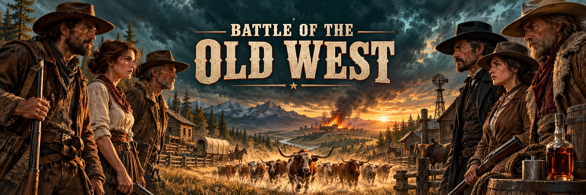
</p>

<p align="center">
  <strong>A cinematic card-battle game set in the historical American West, built in Unreal Engine 5.</strong>
</p>

<p align="center">
  <a href="#how-to-play"><strong>How to play</strong></a> ·
  <a href="#screenshots"><strong>Screenshots</strong></a> ·
  <a href="#get-started"><strong>Get started</strong></a> ·
  <a href="game/PLAYER_GUIDE.md"><strong>Player guide</strong></a> ·
  <a href="game/README.md"><strong>Development</strong></a>
</p>

---

Two rival outfits each hold three properties on the frontier. You spend whiskey to put crew in front of your buildings, light the fuse on Trouble, spook a longhorn Stampede toward the enemy, and burn out all three of their holdings before they burn out yours. Every person and building on the board is a researched, sourced piece of Western history rendered in full colour.

<p align="center">
  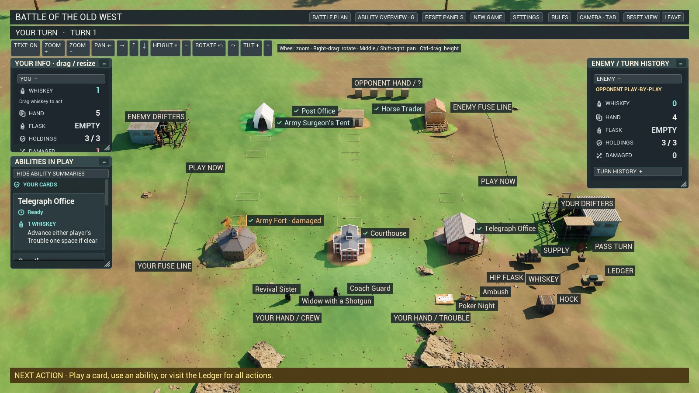
</p>

## Features

- **Solo or head-to-head.** Easy, Normal and Hard opponents that play by the same rules and see only their own cards. Host a match for a friend over LAN, Tailscale or a forwarded port, with seat reclaim after a dropped connection and rematches.
- **A physical battlefield.** Your hand stands behind your holdings as real figures and props. Right-click any model for its legal moves, or drag it to a lit destination. Wounded crew kneel; damaged holdings burn; burned-out holdings leave rubble and smoke.
- **Cinematic moves.** Deliveries arrive by ox wagon, the Stampede thunders down the fuse line, and a fall holds the shot until the body settles. Skip any shot without changing the move.
- **Three regions.** Matches play out on desert, prairie or forest terrain with region-specific scenery.
- **A historical cast.** 46 distinct crew members including three named Native leaders, 34 base holdings and 32 Boomtown holdings. Every one has dated, located, sourced evidence behind it and a short history note under an optional History link in the inspector. Fictional composites are labelled as such.
- **Rules you can trust.** A portable C++ engine validates every action and resolves every turn. Multiplayer clients receive private views only. An offline, searchable rules guide with explanations of all 104 cards is one click away during play.
- **Readable state.** Draggable, resizable info panels, a two-turn history feed, readiness markers beside every name, and an ability overview you open and close with the **G** key.

## How to play

### The goal

Destroy all three of the opponent's holdings. A holding takes two hits: the first damages it, the second burns it out. Some holdings add other ways to win; read their abilities before choosing.

### Setup

Each player is offered six holdings and keeps three, choosing left to right. Each holding shows a starting-card value; their total sets your opening hand. Both players draw from one shared deck.

### Your turn

1. **Trouble resolves.** Any Trouble card of yours that has reached the front of the fuse line goes off now.
2. **Supply.** You draw a card and collect three whiskey. Unspent whiskey from last turn is gone.
3. **Act as often as you can afford.** Any of these, in any order, as long as the whiskey lasts:
   - **Deploy crew.** Pay the card's cost and put a crew member in a column, in front of or behind a holding. Each column holds up to two crew.
   - **Light Trouble.** Pay its cost and set the card on your fuse line at the position its countdown shows. It burns forward one notch each turn and resolves when it reaches the front. A zero-delay card resolves immediately.
   - **Use an ability.** Ready holdings and crew can use their printed ability for its whiskey cost. Each card acts once per turn.
   - **Draw.** Two whiskey for one card.
   - **Hock a card.** Discard a card from hand for its hock effect: draw, patch up, hit, hire a drifter, spook the herd, or take a whiskey.
4. **Pass the turn.**

### Cover, hits and wounds

The front card in a column covers everything behind it. Most attacks can only reach an exposed card, so crew standing in front of a holding soak up the fire. A hit on crew wounds them; a second hit destroys them. A drifter falls to a single hit. Patch-up effects remove a wound or a holding's damage.

### Drifters

Some effects hire a drifter: the top card of the deck placed face down as a crew member with no ability. It covers like anyone else. A few holdings let you look at a drifter's face or flip one face up to play it.

### The Stampede

Both players share one Stampede card. Spooking the herd puts it on your fuse line or moves it one notch closer. When it reaches the front, your opponent picks one of their holdings to take the hit. Then the Stampede returns, ready to be spooked again.

### Hip Flask

One shot of whiskey can be stowed for a later turn instead of being lost. Drag whiskey to the flask to store it, and take it back when you need it.

### Boomtown

Switch on **+ Boomtown** before a match to add 32 more holdings to the offer. The base game uses the revised 34.

For every control, drag route, and panel, see the [player guide](game/PLAYER_GUIDE.md). For connection setup, see [remote play](game/REMOTE_PLAY.md).

## Screenshots

**Start screen.** Choose the base game or Boomtown, pick a difficulty, or host and join a match.

<p align="center">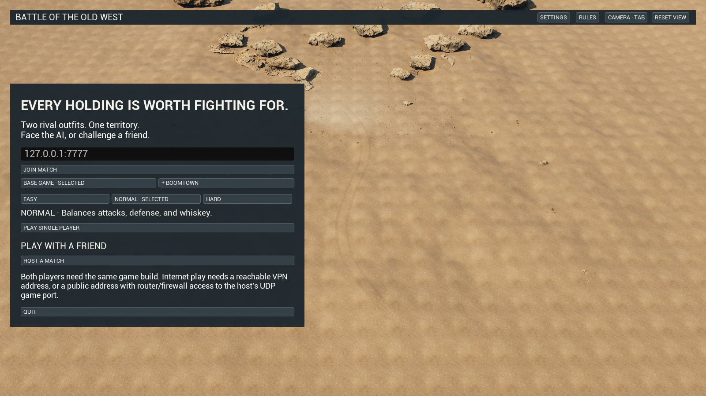</p>

**Choose your holdings.** Six are offered; keep three in left-to-right order.

<p align="center">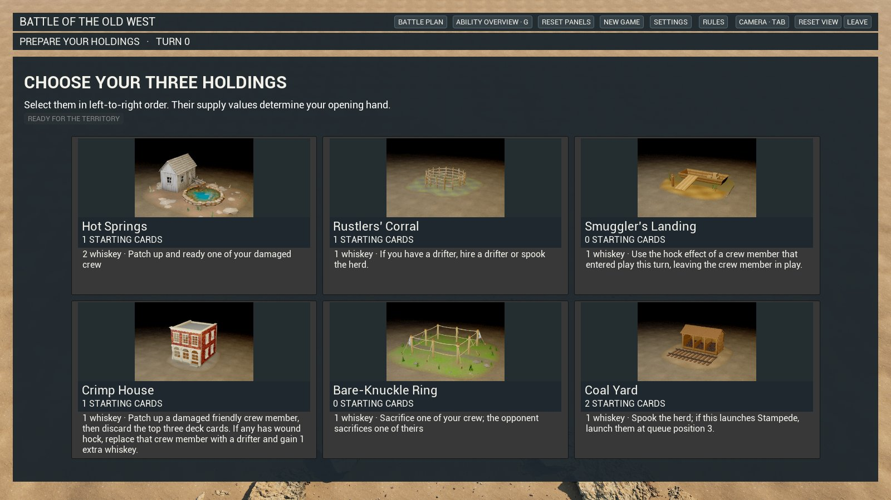</p>

**Desert and forest regions.** Each match draws one of three terrains.

<p align="center">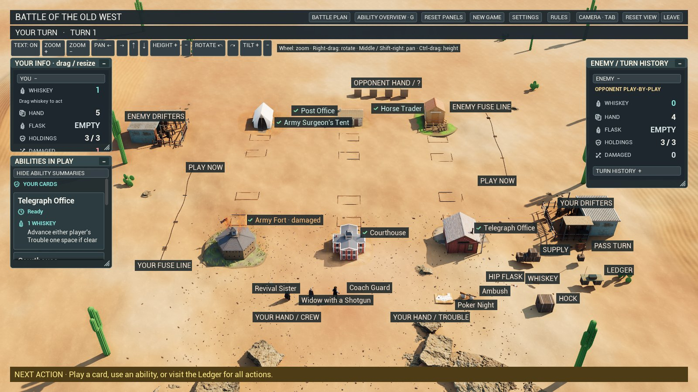</p>
<p align="center">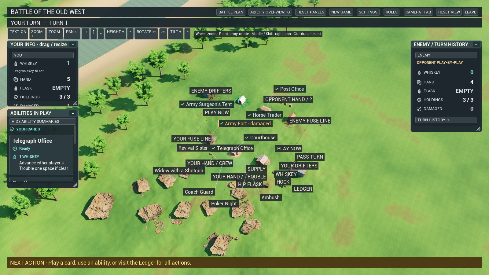</p>

**Inspect any card.** Click a model or panel card for its abilities, condition, cover, and the optional History link.

<p align="center">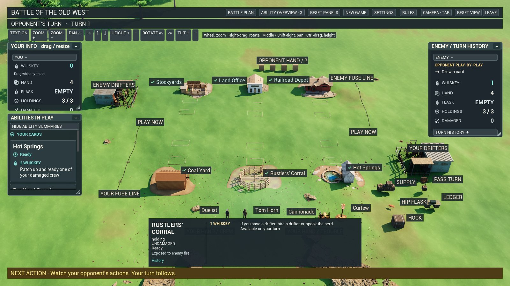</p>

**Cinematic deliveries.** Drawing and collecting whiskey arrive by ox wagon.

<p align="center">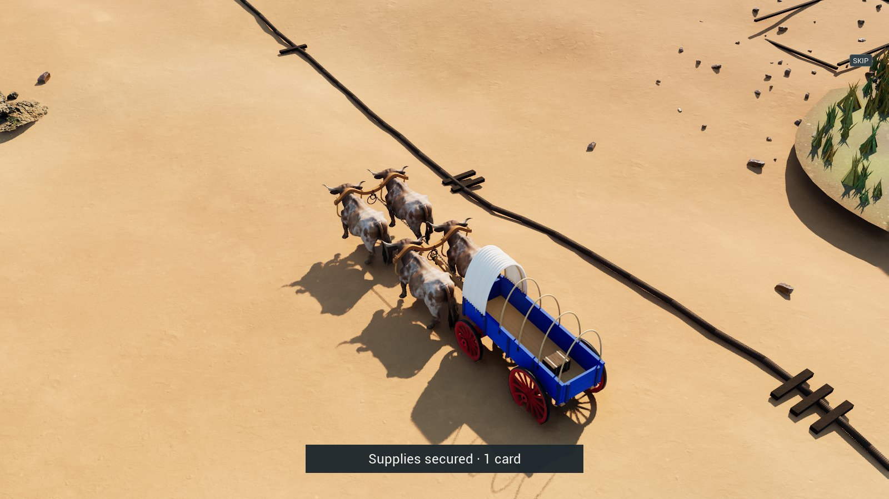</p>

**Rules at hand.** A searchable offline guide with every card explained in Western terms.

<p align="center">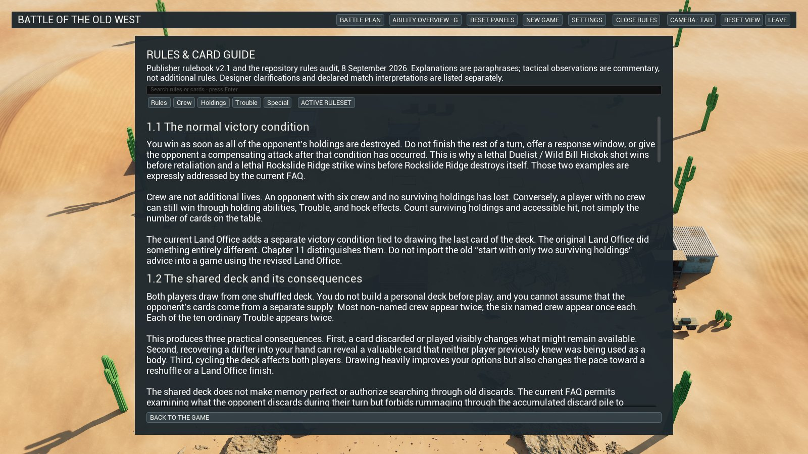</p>

**The crew.** All 46 distinct people, each historically documented.

<p align="center">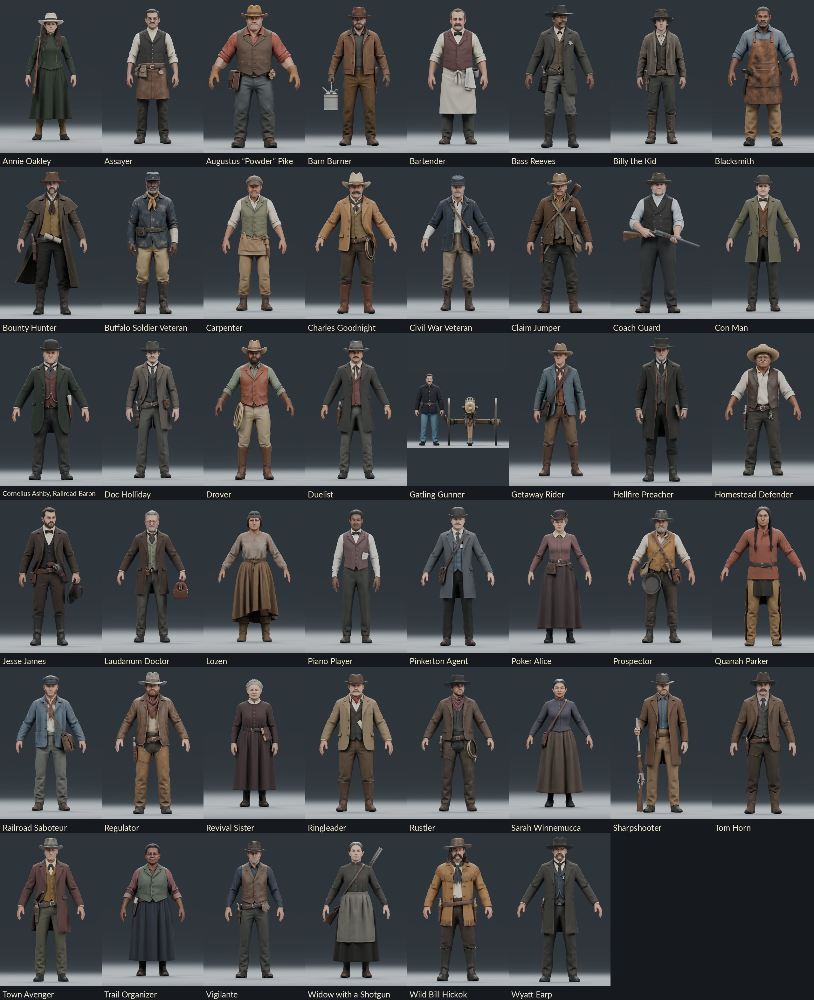</p>

**Native leaders.** Quanah Parker (Comanche, 1870s), Lozen (Chihenne Chiricahua Apache, 1880s) and Sarah Winnemucca (Northern Paiute, 1870s), awaiting tribal review before art lock.

<p align="center">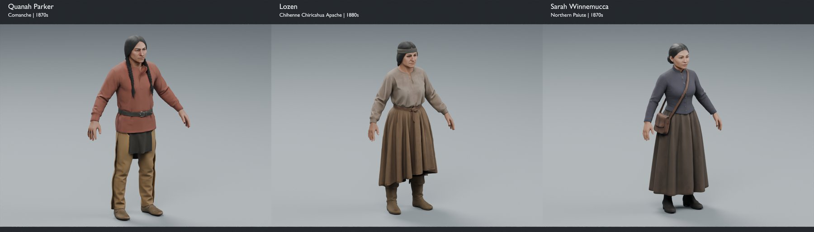</p>

**The base holdings.** All 34 in full colour on their setting bases.

<p align="center">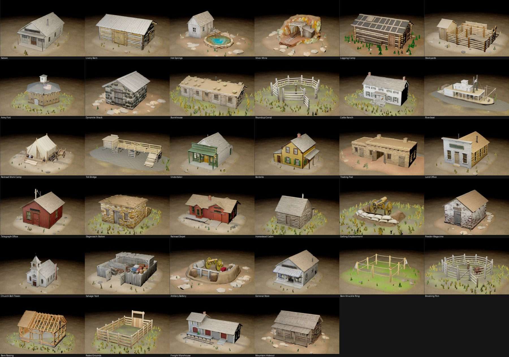</p>

**The Stampede.** The longhorn reference behind the herd that runs the fuse line.

<p align="center">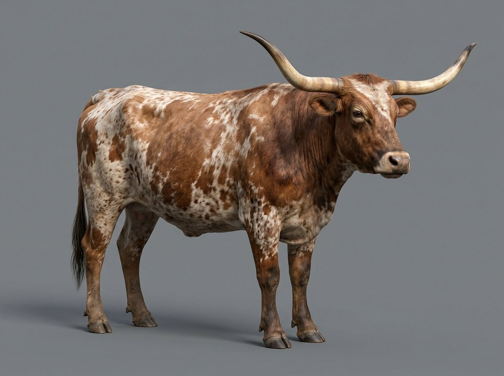</p>

## Get started

**Play an existing Linux package.** If your workspace has a packaged build selected by `dist/current`, run this from the repository root:

```bash
./scripts/launch_battle_of_the_old_west.sh
```

A copied package has its own `launch_battle_of_the_old_west.sh`. Choose **Play Single Player** for an offline match, or **Host a Match** / **Join Match** for two-player play.

**Develop from a fresh clone.** The portable rules and AI tests build without Unreal. Complete game builds also need Unreal Engine 5.8 and the local art assets, which this repository does not carry. See [repository scope](REPOSITORY.md).

<details>
<summary><strong>Run the portable C++ rules and AI tests</strong></summary>

Requires CMake 3.20 or newer and a C++20 compiler.

```bash
cmake -S game/tests/core -B /tmp/old-west-core-build -DCMAKE_BUILD_TYPE=Release
cmake --build /tmp/old-west-core-build -j2
ctest --test-dir /tmp/old-west-core-build --output-on-failure
```

For Unreal builds, packaging and native runtime checks, see the [game development guide](game/README.md#build-and-test).

</details>

**Status: active development.** The Western presentation has its first playable pass. Final appearance approval of the 34 base holdings and the Native review are still open. Linux development packages are validated on the workstation; second-computer play, Internet connectivity and Windows builds remain unvalidated.

## Find your way around

- [**Game source and setup**](game/README.md) — Unreal project, gameplay systems, build instructions and runtime checks.
- [**Art and history guardrails**](game/REBRAND_GUARDRAILS.md) — documented historical accuracy, the appearance-approval gate and the mechanics freeze.
- [**Card catalog**](game/data/cards.json) — the structured definitions the game runs on. Canonical IDs are frozen; the Western names live in [`game/data/western-terms.json`](game/data/western-terms.json).
- [**Rules and AI core**](game/OldWest/Source/OldWestGame/Private/Core/) — portable C++ gameplay logic.
- [**Research**](research/) — historical evidence for every rendered person and building.
- [**Build and validation scripts**](scripts/) — asset authoring, packaging and checks.

## License

Original source code, scripts and their associated software documentation are licensed under the [MIT License](LICENSE), copyright © 2026 VincentAZ, unless otherwise marked.

This grant does not cover card text or card data, artwork, audio, research materials or other non-code assets. The underlying game design and its original materials remain the property of their respective rights holders; this license grants no rights to those materials or trademarks. Third-party code, Unreal Engine, Epic content and other third-party assets retain their own licenses. See [third-party notices and asset credits](game/THIRD_PARTY_NOTICES.md).

---

<sub>Unofficial fan project; not affiliated with or endorsed by the original game's publisher.</sub>
